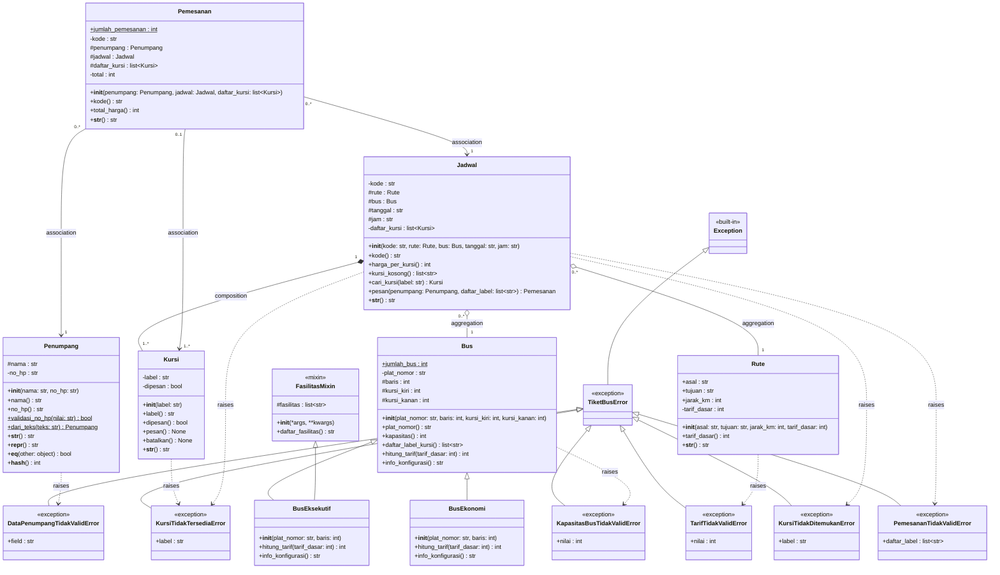

# Pemesanan Tiket Bus Antarkota — Exception Handling

Pengembangan proyek UTS Pemrograman Berorientasi Objek (Kasus 8: **Pemesanan Tiket Bus Antarkota**) dengan menambahkan penanganan pengecualian (*exception handling*) di Python.

## 1. Identitas

**Kelompok:** (isi nomor kelompok)

| Nama | NIM | Akun Git |
| :--- | :--- | :--- |
| I Komang Nanda Anggara Putra | 2501020046 | komangnandaanggara-hue |
| Muhamad Afif | 2501020064 | muhamadafif2303202-code |
| Tehillah Kim Theodore Kajeng | 2501020057 | tehiilah |

## 2. Deskripsi Sistem

Sistem digunakan oleh penumpang dan petugas operator. Operator mengelola rute perjalanan serta armada bus yang terdiri dari bus eksekutif (konfigurasi kursi 2-2, kursi A–D, tarif 1,5 kali tarif dasar) dan bus ekonomi (konfigurasi kursi 2-3, kursi A–E, tarif sama dengan tarif dasar). Operator membuat jadwal keberangkatan dengan menghubungkan satu rute dan satu bus. Penumpang memilih jadwal, memilih satu atau beberapa kursi kosong, lalu membuat pemesanan. Sistem memeriksa ketersediaan kursi secara atomik, menolak pemesanan yang melanggar aturan bisnis, menghitung tarif sesuai jenis bus, dan menghitung total biaya.

Kelas domain: `FasilitasMixin`, `Bus`, `BusEksekutif`, `BusEkonomi`, `Kursi`, `Rute`, `Penumpang`, `Jadwal`, `Pemesanan`.

## 3. Aturan Bisnis dan Exception

| No | Aturan Bisnis | Class / Method yang Menegakkan | Exception |
| :--- | :--- | :--- | :--- |
| 1 | Kursi yang sudah dipesan tidak boleh dipesan lagi | `Kursi.pesan()`, `Jadwal.pesan()` | `KursiTidakTersediaError` |
| 2 | Label kursi harus terdaftar pada denah bus di jadwal tersebut | `Jadwal.cari_kursi()` | `KursiTidakDitemukanError` |
| 3 | Nama penumpang tidak boleh kosong, nomor HP harus 10–13 digit angka, dan format teks harus `Nama; NoHP` | setter `Penumpang.nama`, setter `Penumpang.no_hp`, `Penumpang.dari_teks()` | `DataPenumpangTidakValidError` |
| 4 | Tarif dasar dan jarak tempuh rute harus lebih dari nol | setter `Rute.tarif_dasar`, `Rute.__init__()` | `TarifTidakValidError` |
| 5 | Pemesanan minimal memilih satu kursi dan tanpa label kursi ganda | `Jadwal.pesan()` | `PemesananTidakValidError` |
| 6 | Jumlah baris serta konfigurasi kursi kiri dan kanan bus harus bilangan bulat positif | `Bus.__init__()` | `KapasitasBusTidakValidError` |

## 4. Class Diagram Revisi



Keterangan: hierarki exception menggunakan stereotype `«exception»` yang mewarisi `TiketBusError`. Panah putus-putus `«raises»` menunjukkan class yang memunculkan exception tersebut. Notasi visibilitas: `+` public, `#` protected, `-` private.

## 5. Daftar Custom Exception

| Exception | Induk | Atribut Konteks | Dimunculkan Saat | Method yang Memunculkan | Penanganan di Program Utama |
| :--- | :--- | :--- | :--- | :--- | :--- |
| `TiketBusError` | `Exception` | - | Base exception aplikasi | - | `except TiketBusError` sebagai penangkap umum |
| `KursiTidakTersediaError` | `TiketBusError` | `label` | Kursi sudah terisi | `Kursi.pesan()`, `Jadwal.pesan()` | Pesan kursi bentrok beserta label kursinya |
| `KursiTidakDitemukanError` | `TiketBusError` | `label` | Label kursi tidak ada di denah bus | `Jadwal.cari_kursi()` (`raise ... from`) | Pesan kursi tidak ditemukan |
| `DataPenumpangTidakValidError` | `TiketBusError` | `field` | Nama kosong, nomor HP bukan 10–13 digit, atau format teks salah | setter `nama`, setter `no_hp`, `dari_teks()` (`raise ... from`) | Pesan data salah beserta nama `field`-nya |
| `TarifTidakValidError` | `TiketBusError` | `nilai` | Tarif dasar atau jarak tempuh $\le 0$ | setter `Rute.tarif_dasar`, `Rute.__init__()` | Penolakan di blok `try` validasi master data |
| `PemesananTidakValidError` | `TiketBusError` | `daftar_label` | Daftar kursi kosong atau terdapat label kursi ganda | `Jadwal.pesan()` | Ditangkap oleh `except PemesananTidakValidError` / `TiketBusError` |
| `KapasitasBusTidakValidError` | `TiketBusError` | `nilai` | Jumlah baris atau konfigurasi kursi bus $\le 0$ | `Bus.__init__()` | Penolakan di blok `try` validasi master data |

Teknik penanganan pengecualian yang diterapkan:

- **Blok Lengkap `try`, `except`, `else`, `finally`:** Diterapkan pada fungsi `proses_pemesanan()` dan pengujian validasi master data di `src/main.py`. Blok `else` mencetak tiket yang berhasil terbit saat tidak ada exception, sedangkan `finally` selalu menampilkan sisa kursi kosong pada jadwal.
- **EAFP (*Easier to Ask for Forgiveness than Permission*):** `Jadwal.cari_kursi()` langsung mengakses dictionary denah kursi lalu menangani `KeyError`; `Penumpang.dari_teks()` langsung melakukan *unpacking* hasil `split(";")` lalu menangani `ValueError`.
- **`raise ... from` (Exception Chaining):** Kedua method di atas membungkus exception bawaan (`KeyError` dan `ValueError`) menjadi custom exception tanpa menghilangkan penyebab aslinya (`__cause__`).
- **Re-raise:** `buat_pemesanan()` di `src/main.py` mencatat log penolakan transaksi lalu memunculkan ulang exception dengan perintah `raise` agar ditangani oleh pemanggil di tingkat atas.
- **Validasi Atomik Sebelum Mengubah State:** `Jadwal.pesan()` memeriksa seluruh kursi yang diminta terlebih dahulu sebelum memanggil `kursi.pesan()`, sehingga pemesanan yang gagal pada salah satu kursi tidak meninggalkan kursi lain dalam keadaan setengah terpesan.

## 6. Struktur Repository

```text
.
├── README.md
├── docs/
│   └── output.txt             (hasil eksekusi program utama)
└── src/
    ├── exceptions.py          (hierarki custom exception)
    ├── models.py              (class domain)
    └── main.py                (program utama)
```

## 7. Cara Menjalankan

Membutuhkan Python 3.8 atau lebih baru, tanpa library tambahan.

```bash
python src/main.py
```

Contoh output (potongan):

```text
1. Pemesanan valid
  [OK] PSN001 | Budi Santoso | Kursi 1A, 1B | Rp600,000
  Kursi kosong tersisa: 18
2. Kursi sudah dipesan
  [LOG] pemesanan ditolak: KursiTidakTersediaError
  [GAGAL] Kursi bentrok (kursi 1B): Kursi 1B sudah dipesan
  Kursi kosong tersisa: 18
```

Output lengkap tersedia di [docs/output](tiket_bus.docx).

## 8. Pembagian Peran

| Anggota | Peran |
| :--- | :--- |
| I Komang Nanda Anggara Putra | Implementasi `src/exceptions.py` (hierarki custom exception) dan penyusunan tabel aturan bisnis |
| Muhamad Afif | Implementasi dan pembaruan validasi class domain pada `src/models.py` |
| Tehillah Kim Theodore Kajeng | Implementasi `src/main.py`, penyusunan revisi class diagram, dan dokumentasi `README.md` |
